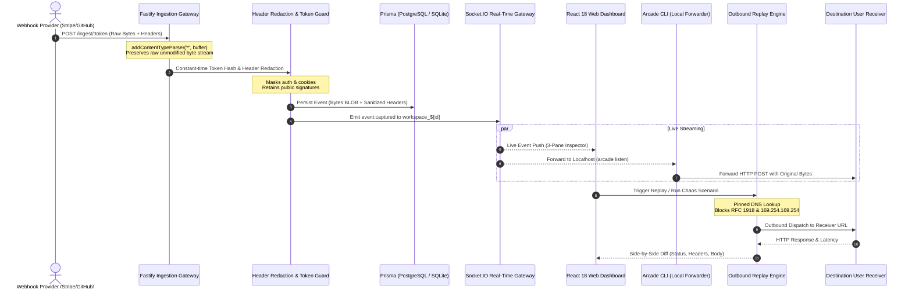
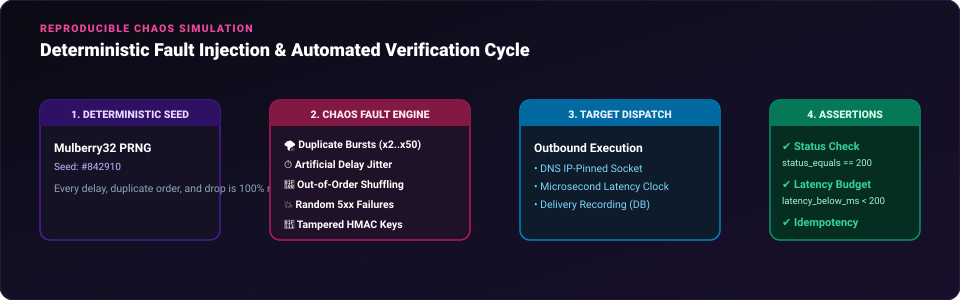

<p align="center">
  <picture>
    <source media="(prefers-color-scheme: dark)" srcset="assets/hero-banner.svg">
    
  </picture>
</p>

<p align="center">
  <strong>Every webhook. Every event. Every possibility. One playground.</strong><br>
  <em>The modern, open-source reliability playground for capturing, inspecting, replaying, and stress-testing HTTP webhooks against duplicate storms, latency jitter, and signature tampering.</em>
</p>

<p align="center">
  <a href="https://github.com/ibpofficial/webhookarcade/blob/main/LICENSE"></a>
  <a href="https://github.com/ibpofficial/webhookarcade/releases"></a>
  <a href="#"></a>
  <a href="#"></a>
  <a href="#"></a>
  <a href="#"></a>
  <a href="#"></a>
  <a href="#"></a>
</p>

<p align="center">
  <a href="#quick-start-under-3-commands">Quick Start</a> •
  <a href="#why-webhook-arcade">Why Webhook Arcade?</a> •
  <a href="#architecture--data-flow">Architecture</a> •
  <a href="#core-features-in-depth">Features</a> •
  <a href="#chaos-lab--fault-injection">Chaos Lab</a> •
  <a href="#arcade-cli--local-forwarding">Arcade CLI</a> •
  <a href="#honest-comparison">Comparison</a> •
  <a href="#how-it-was-made-open-source">Open Source Design</a> •
  <a href="#verification--quality-gates">Verification</a> •
  <a href="#documentation">Documentation</a>
</p>

---

## What is Webhook Arcade?

**Webhook Arcade** is an open-source developer tool and reliability playground for building, debugging, and hardening webhook receivers.

In production, webhook failures are rarely caused by simple syntax errors. They fail because:
1. **Duplicate delivery storms** trigger duplicate billing or inventory allocation when receivers lack idempotency.
2. **Out-of-order deliveries** arrive before account records exist (e.g. `order.fulfilled` arriving before `order.created`).
3. **Network latency jitter and drops** cause third-party providers (Stripe, GitHub, Shopify) to retry relentlessly until endpoints saturate.
4. **Signature verification edge cases** fail because parsers mutate raw whitespace or fail under timestamp drift.
5. **Outbound testing tools** introduce dangerous SSRF vulnerabilities against internal networks (`169.254.169.254`, VPCs, loopback interfaces).

Webhook Arcade gives developers a **zero-dependency, production-grade sandbox** that captures real HTTP webhooks, validates cryptographic HMAC signatures against raw bytes, dispatches outbound replays with DNS IP-pinned SSRF protection, and injects reproducible chaos scenarios with automated assertion testing.

The core workflow works instantly without requiring an account, credit card, or external tunnel:
```
1-Click Ephemeral Sandbox → Ingest Real Webhook → Live WebSocket Stream → Cryptographic Verification → Outbound Replay Diff
```

---

## Quick Start (Under 3 Commands)

### Option 1: Docker Compose (Instant Deployment)

```bash
git clone https://github.com/ibpofficial/webhookarcade.git
cd webhookarcade
docker compose up -d
```

Open your browser to:
- **Web Dashboard**: [http://localhost:5173](http://localhost:5173) (or [http://localhost:5174](http://localhost:5174))
- **API & Ingestion Receiver**: [http://localhost:4000](http://localhost:4000)
- **Interactive OpenAPI Documentation**: [http://localhost:4000/docs](http://localhost:4000/docs)

### Option 2: Local Development (pnpm + Zero-Config SQLite)

Webhook Arcade features a built-in SQLite database mode so you can run the entire monorepo locally without installing PostgreSQL or Docker:

```bash
# 1. Install dependencies
pnpm install

# 2. Generate Prisma SQLite client
pnpm --filter @webhook-arcade/database run prisma:generate:sqlite

# 3. Start API, CLI, and Web dev servers simultaneously
pnpm dev
```

### Send Your First Webhook in 5 Seconds:

```bash
# Ingest an event directly into the local sandbox
curl -X POST "http://localhost:4000/ingest/demo" \
  -H "Content-Type: application/json" \
  -H "X-Custom-Header: arcade-live-test" \
  -d '{"event":"checkout.session.completed","customer":"cust_9941","amount":7500,"currency":"usd"}'
```

Watch the event immediately stream into the 3-pane Webhook Inbox over WebSockets with headers, payload, and cURL snippets ready to copy.

---

## Why Webhook Arcade?

| Problem in Production | The Traditional Workaround | The Webhook Arcade Way |
|---|---|---|
| **Untested Idempotency** | Hoping `stripe-event-id` checks work under load | **Chaos Lab Duplicate Storms**: Dispatch $N$ concurrent identical events with seeded RNG and automated idempotency assertions. |
| **Out-of-Order Deliveries** | Writing complicated mock code | **Order Inversion Engine**: Deliberately delay event 1 so event 2 arrives first to verify receiver resilience. |
| **Broken Signatures in Dev** | Commenting out signature verification code | **Multi-Scheme Signature Inspector**: Real-time HMAC verification (GitHub, Stripe, generic) calculated against unmodified raw bytes. |
| **Dangerous Outbound Replays** | Testing against staging using curl scripts | **DNS IP-Pinned Replay Engine**: Multi-hop SSRF validation blocking cloud metadata (`169.254.169.254`), loopback, and IPv6 bypasses. |
| **Expensive SaaS Tunnels** | Paying monthly fees for ngrok or Hookdeck | **Built-in Arcade CLI Forwarder**: Stream cloud webhooks directly to `localhost:3000` over authenticated Socket.IO without third-party tunnels. |
| **Re-Serialization Corruption** | JSON parsers modifying spacing or byte order | **Byte-Exact Raw Buffering**: Buffers raw bytes into Node.js Buffers before JSON parsing; preserves unmodified signature payloads. |

---

## Architecture & Data Flow

<p align="center">
  <picture>
    <source media="(prefers-color-scheme: dark)" srcset="assets/architecture-diagram.svg">
    
  </picture>
</p>

### The 7-Stage Webhook Lifecycle



---

## Core Features in Depth

### 1. Webhook Inbox & Live Inspector
- **Instant 1-Click Sandbox**: Ephemeral guest developer sessions generate working webhook receivers instantly without email or registration.
- **Capture First, Judge Later**: Ingests JSON, urlencoded, plain text, XML, binary, and malformed bodies without dropping requests. Malformed payloads are flagged (`isInvalidJson: true`) so developers can diagnose corrupted payloads.
- **Exact Raw Byte Preservation**: Buffers raw byte streams into memory before parsing. Stored as `Bytes` in PostgreSQL/SQLite to guarantee cryptographic HMAC signatures match provider inputs without whitespace drift.
- **Sensitive Credential Redaction**: Automatically scrubs authorization tokens, cookies, API keys, and proxy credentials into `[REDACTED]` while retaining audit metadata. Signature headers (`stripe-signature`, `x-hub-signature-256`) are preserved intact.
- **Apple HIG 3-Pane Split View**: Information-dense inspector with keyboard navigation, method badges, live search filters, and an interactive React Flow pipeline diagram.
- **Real-Time Purge**: Single-click event purge (`DELETE /api/endpoints/:id/events`) to reset inbox state between test runs.

### 2. Cryptographic Signature Verification
Webhook Arcade includes a dedicated signature verification engine (`packages/signatures`) wired directly to stored raw byte streams via `POST /api/events/:id/verify-signature`:
- **GitHub (`x-hub-signature-256`)**: Calculates `sha256=${hmacSha256(secret, rawBytes)}` and compares in constant time.
- **Stripe (`stripe-signature`)**: Parses `t=...,v1=...` headers, enforces tolerance windows (default: 300s) to prevent replay attacks, and signs `${timestamp}.${rawBytes}`.
- **Generic HMAC**: SHA-256 and SHA-1 hex digest validation.
- **Tampering Generator**: Intentionally corrupts raw bytes or modifies signatures to verify that your webhook receiver properly rejects fraudulent payloads with HTTP 401/403.

### 3. Safe Outbound Replay Engine with SSRF Protection
The Replay Engine (`packages/replay-engine`) lets you re-dispatch historical webhooks to any staging, local, or production URL with multi-hop SSRF security:
- **DNS IP-Pinning**: Resolves hostnames via `dns.promises.lookup` and pins the outbound connection socket directly to the validated IP. This completely prevents Time-of-Check to Time-of-Use (TOCTOU) DNS rebinding attacks.
- **16-Bit Word IPv6 Parser**: Inspects every 16-bit word of IPv6 addresses, blocking IPv4-mapped IPv6 in both dot-decimal and hexadecimal notation (e.g. `::ffff:7f00:1`), NAT64 (`64:ff9b::/96`), 6to4 (`2002::/16`), documentation (`2001:db8::/32`), ULA (`fc00::/7`), and loopback (`::1`).
- **Multi-Hop Redirect Security**: Validates target IPs across every HTTP redirect hop. If a public server attempts to redirect into `169.254.169.254` or internal RFC 1918 subnets, the request is intercepted and terminated.
- **Response Diff Viewer**: Displays side-by-side comparisons of original vs replayed responses, highlighting status code discrepancies, header changes, body differences, and latency metrics.

---

## Chaos Lab & Fault Injection

<p align="center">
  <picture>
    <source media="(prefers-color-scheme: dark)" srcset="assets/chaos-loop.svg">
    
  </picture>
</p>

The **Chaos Lab** (`packages/chaos-engine`) is Webhook Arcade's automated reliability suite. It subjects your webhook receivers to real-world distributed systems chaos:

### Fault Injection Capabilities

1. **Duplicate Storms**: Sends $N$ identical webhooks in rapid burst succession to ensure your receiver processes business logic exactly once (idempotency test).
2. **Artificial Delay Jitter**: Injects controlled latency delays (0 to 30,000ms) to verify that your upstream receiver does not drop connections or exceed gateway timeouts.
3. **Out-of-Order Shuffling**: Reverses or shuffles event sequences (e.g. delivering `invoice.paid` before `customer.created`) to verify state machine robustness.
4. **Random 5xx Failures**: Simulates upstream gateway timeouts and internal server errors.
5. **Tampered HMAC Checksums**: Mutates signature bytes to ensure fraudulent webhooks are rejected.
6. **Concurrency Bursts**: Dispatches concurrent batches of requests simultaneously to stress-test database lock contention and race conditions.

### Deterministic Seeded RNG
Chaos runs utilize a Mulberry32 Pseudorandom Number Generator (PRNG). By sharing an RNG seed (e.g. `#842910`), developers and CI pipelines can **reproduce the exact same sequence of delays, duplicates, and drops down to the millisecond**.

### Automated Assertions Engine
Evaluate receiver behavior automatically without writing custom test harnesses:
- `status_equals`: Asserts that all deliveries receive expected status (e.g. `200 OK`).
- `latency_below_ms`: Asserts that receiver response latency remains within a budget (e.g. `< 250ms`).
- `body_jsonpath_equals`: Validates JSON responses via JSONPath expressions.
- `idempotent_processed_once`: Validates that duplicated events only execute side-effects once.

### Built-in Demo Target
Webhook Arcade includes built-in demo receivers for zero-configuration testing:
- `/demo/naive`: A vulnerable receiver with zero idempotency handling (fails duplicate storms).
- `/demo/idempotent`: An idempotency-key protected receiver (passes duplicate storms).

---

## Arcade CLI & Local Forwarding

The **Arcade CLI** (`apps/cli`) streams cloud webhooks into local development environments without third-party tunnels (ngrok, localtunnel, cloudflared).

### CLI Installation

```bash
# Global installation via pnpm or npm
npm install -g @webhook-arcade/cli

# Verify version
arcade --version
```

### Essential CLI Commands

```bash
# 1. Authenticate with your Webhook Arcade instance (saves config to ~/.arcade/config.json with 0600 permissions)
arcade login

# 2. List your active webhook endpoints
arcade endpoint list

# 3. Create a new receiver endpoint from your terminal
arcade endpoint create --name "Local Stripe Receiver"

# 4. Stream live webhooks directly to your local development server
arcade listen --to http://localhost:3000/api/webhooks

# 5. List captured events with status, size, and timestamp
arcade events --limit 10

# 6. Replay any historical event directly from the terminal
arcade replay <eventId> --to http://localhost:3000/api/webhooks
```

### Live Terminal Forwarder Preview

```
┌────────────────────────────────────────────────────────────────────────┐
│ arcade listen --to http://localhost:3000/api/webhooks                  │
├────────────────────────────────────────────────────────────────────────┤
│ ✔ [CONNECTED] Socket.IO handshake authenticated (workspace_8b21a)      │
│ Forwarding live inbound webhooks to: http://localhost:3000/api/webhooks│
│                                                                        │
│ [13:30:12] POST /ingest/wha_live_7a8b99c...                            │
│ Event: customer.subscription.created • Size: 2.1 kB                    │
│ ↳ HTTP 200 in 16ms (Receiver acknowledged idempotency)                 │
│                                                                        │
│ [13:30:15] [CHAOS BURST] Duplicate Event Delivery (2 of 3)             │
│ Event: customer.subscription.created • Size: 2.1 kB                    │
│ ↳ HTTP 200 in 8ms (Idempotent duplicate acknowledged)                  │
└────────────────────────────────────────────────────────────────────────┘
```

---

## Honest Comparison

| Capability | Webhook Arcade | Webhook.site | Hookdeck | ngrok |
|---|---|---|---|---|
| **License** | **100% Open-Source (MIT)** | Commercial / Freemium | Commercial SaaS | Commercial / Proprietary |
| **Chaos & Fault Injection** | **Built-in (Duplicates, Bursts, Delays, Jitter)** | Not supported | Transformations only | Not supported |
| **Deterministic Seeded RNG** | **Yes (Mulberry32 PRNG)** | No | No | No |
| **Automated Assertions** | **Built-in (Status, Latency, Idempotency)** | No | No | No |
| **Self-Hosted Deployment** | **Docker Compose (Full Stack)** | Docker image available | Cloud only | Relay cloud only |
| **Zero-Config Local Mode** | **SQLite + In-Memory Queue** | Requires Redis/DB | Cloud only | Account required |
| **Replay SSRF Protection** | **DNS IP-Pinning & Cloud Metadata Block** | Manual replay | Queue retries | Tunnel replay |
| **Raw Byte Preservation** | **Exact Buffer Storage (No JSON Re-encode)** | Stringified | Normalized | Raw stream |
| **Built-in Tunnel Forwarder** | **Yes (`arcade listen`)** | Paid feature | CLI tunnel | Tunnel only |
| **Interactive Demo Targets** | **Built-in (`/demo/idempotent`)** | No | No | No |

---

## How It Was Made Open Source

Webhook Arcade was created to give the developer community a **transparent, sovereign, zero-lock-in alternative** to proprietary webhook infrastructure.

### 1. Zero External Cloud Dependencies
Developers should be able to run complete integration tests offline on an airplane. Webhook Arcade operates completely without:
- Cloud accounts or credit cards
- External tunneling relay services
- Mandatory cloud databases (features automatic fallback to SQLite)
- Third-party AI APIs (keeps tests fast, local, and private)

### 2. Dual Database Architecture
Configured through `@webhook-arcade/database`:
- **Local Developer Mode**: File-backed SQLite (`USE_SQLITE=true`). Zero configuration, instant startup.
- **Production Mode**: PostgreSQL with connection pooling and JSONB indexing for high-throughput enterprise multi-tenancy.

### 3. Strict Anti-Slop Code Quality
Webhook Arcade enforces rigorous coding standards:
- **No Simulated Data**: All endpoints, CLI commands, and UI panels operate against real database records and cryptographic algorithms.
- **Apple HIG & Material 3**: Thoughtfully designed 3-pane split layouts, WCAG AA contrast compliance, high-contrast focus rings, and purposeful micro-interactions.
- **TypeScript Strictness**: Zero `any` casts in core validation and database mapping logic.

---

## Monorepo Topology

```
webhook-arcade/
├── apps/
│   ├── web/                     # React 18 + Vite + Tailwind CSS + React Flow dashboard
│   ├── api/                     # Fastify 4 + Socket.IO real-time ingestion & management API
│   └── cli/                     # Arcade CLI (Commander + Picocolors) for local forwarding
├── packages/
│   ├── database/                # Prisma ORM, migrations, dual PostgreSQL/SQLite engines
│   ├── shared/                  # Zod schemas, TypeScript types, data contracts, constants
│   ├── webhook-engine/          # Raw buffer parser, header redaction, cURL builder
│   ├── replay-engine/           # DNS IP-pinned outbound dispatcher, SSRF validator, diffing
│   ├── chaos-engine/            # Mulberry32 seeded PRNG, fault injector, assertions evaluator
│   ├── signatures/              # Cryptographic HMAC algorithms (GitHub, Stripe, generic)
│   └── templates/               # Provider payload templates (Stripe, GitHub, Shopify, Clerk)
├── docs/                        # Architecture, API, Security, and Phase audit specifications
└── assets/                      # High-definition SVG graphics and architectural diagrams
```

---

## Verification & Quality Gates

Every component of Webhook Arcade is empirically verified through comprehensive test suites:

```bash
# Run all unit, integration, and build tasks across the entire monorepo:
pnpm test

# Run API security and isolation test suites:
pnpm --filter @webhook-arcade/api test

# Run CLI integration tests (spawns real test server):
pnpm --filter @webhook-arcade/cli test

# Run Playwright End-to-End browser workflow:
pnpm --filter @webhook-arcade/web run test:e2e
```

### Empirical Test Execution Summary:
- **`@webhook-arcade/signatures`**: 4/4 passing (GitHub HMAC, Stripe timestamped v1, generic HMAC, timing-safe comparison).
- **`@webhook-arcade/replay-engine`**: 13/13 passing (IPv4/IPv6 loopback, cloud metadata `169.254.169.254`, IPv4-mapped hex notation, NAT64, 6to4, multi-hop redirect interceptors).
- **`@webhook-arcade/chaos-engine`**: 2/2 passing (Mulberry32 reproducibility, demo target verification).
- **`@webhook-arcade/cli`**: 2/2 passing (help outputs, real guest authentication, endpoint management, event listing, real replay execution).
- **`@webhook-arcade/api`**: 13/13 passing (guest auth, endpoint token constant-time comparison, malformed JSON preservation, signature verification route, event history purge, cross-tenant isolation on all routes, Socket.IO handshake auth & room authorization, replay diffing, chaos execution).
- **`@webhook-arcade/web` (Playwright E2E)**: 1/1 passing (end-to-end sandbox creation, real webhook ingestion, live WebSocket push, event detail inspection, replay dispatch, and side-by-side response comparison diff).

---

## Documentation

- 📐 **[System Architecture](docs/ARCHITECTURE.md)** — In-depth component topology and data flow diagrams.
- 📡 **[API Specification](docs/API.md)** — Complete REST endpoints, request/response contracts, and status codes.
- 🛡️ **[Security Model & SSRF Protection](docs/SECURITY_MODEL.md)** — Multi-hop DNS IP-pinning, IPv6 parsers, and token hashing.
- 🧪 **[Chaos Lab & Assertions](docs/CHAOS_LAB.md)** — Declarative fault injection specifications and assertion syntax.
- 💻 **[Arcade CLI Reference](docs/CLI.md)** — Terminal forwarder commands, flags, and configuration guides.
- 🚀 **[Self-Hosting Guide](docs/SELF_HOSTING.md)** — Production deployment via Docker Compose and environment variable reference.
- 🎨 **[Design System & Tokens](docs/DESIGN_SYSTEM.md)** — Color palettes, typography, and Apple HIG layout guidelines.
- 📋 **[Phase Verification Reports](docs/PHASE_REPORTS.md)** — Empirical verification logs across all build phases.
- 🔍 **[Phase 5 Trust & Reliability Audit](docs/AUDIT_PHASE5.md)** — Full security and core reliability audit findings.

---

## Contributing

We welcome contributions from developers worldwide! Whether you are adding a new webhook provider template, writing an assertion rule, or improving CLI performance:

1. Fork the repository on GitHub.
2. Clone your fork locally and install dependencies: `pnpm install`.
3. Create a feature branch: `git checkout -b feature/my-new-feature`.
4. Ensure all tests pass: `pnpm test`.
5. Submit a pull request. Please review our [Contributing Guidelines](CONTRIBUTING.md) and [Code of Conduct](CODE_OF_CONDUCT.md).

---

## License

Webhook Arcade is completely open-source software licensed under the [MIT License](LICENSE).
