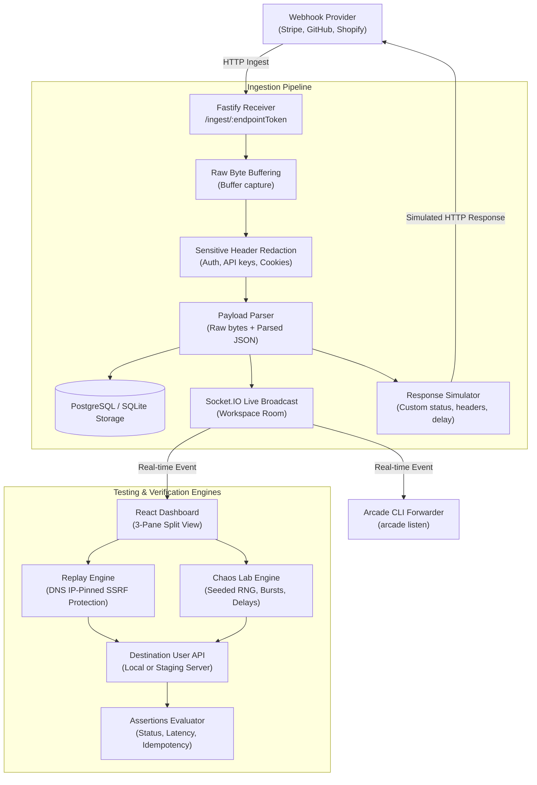

# Webhook Arcade - System Architecture

## Overview

Webhook Arcade is an open-source webhook reliability testing playground designed for high-throughput ingestion, safe outbound delivery replays, and reproducible chaos fault injection.



---

## Monorepo Package Topology

```
webhook-arcade/
├── apps/
│   ├── web/                 # React + TypeScript + Vite + Tailwind CSS dashboard
│   ├── api/                 # Fastify backend + Ingest receiver + Socket.IO server
│   └── cli/                 # Arcade CLI (Commander) for local tunneling
├── packages/
│   ├── database/            # Prisma ORM, migrations, dual PostgreSQL/SQLite adapters
│   ├── shared/              # Zod validation schemas, data contracts, constants
│   ├── webhook-engine/      # Raw byte capture, header redaction, cURL snippet builder
│   ├── replay-engine/       # DNS IP-pinning outbound client, SSRF validator, diffing
│   ├── chaos-engine/        # Seeded RNG fault injector, assertions evaluator, demo target
│   ├── signatures/          # HMAC algorithms (GitHub, Stripe, generic) & tampering generator
│   └── templates/           # Realistic provider templates (Stripe, GitHub, Shopify, Clerk)
```

---

## Data Flow & Ingestion Lifecycle

1. **Capture First, Judge Later**:
   - The public ingestion route (`ANY /ingest/:endpointToken`) captures raw body bytes into a Node.js `Buffer`.
   - Requests are never rejected for malformed JSON or unparseable text. Malformed bodies are flagged (`isInvalidJson: true`) and preserved as exact bytes so developers can debug broken incoming payloads.

2. **Cryptographic Integrity**:
   - Webhook providers sign exact byte streams. By storing the body as `Bytes` in PostgreSQL (or binary Buffer in SQLite), HMAC verification routines can accurately validate signatures without JSON stringify whitespace divergence.

3. **Workspace Isolation**:
   - Every endpoint belongs to an isolated `workspaceId`.
   - Socket.IO broadcasts events exclusively to the authenticated `workspace_${workspaceId}` room.
   - API endpoints enforce workspace ownership checks on all query parameters.

4. **Safe Outbound Dispatch (SSRF Protection)**:
   - When executing Replays or Chaos Lab runs, the destination host is resolved via DNS.
   - All resolved IP addresses are checked against private (RFC 1918), loopback, link-local, and cloud metadata (`169.254.169.254`) ranges.
   - The socket connection is pinned directly to the validated IP to prevent DNS rebinding attacks.
